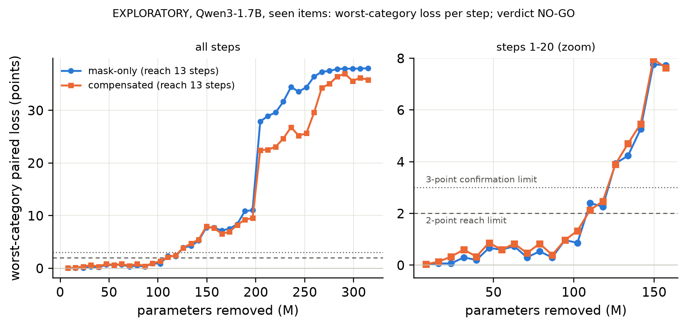

# Compensation feasibility: report (2026-11-26)

**EXPLORATORY.** It ran on the development model Qwen3-1.7B, and every evaluation item has been seen on Qwen before.
The plan, [`compensation_feasibility_plan.md`](compensation_feasibility_plan.md), was committed and pushed (`e9a61d2`)
before any model was scored, and its decision rule was not changed afterwards.

**Sources.** Every number below comes from a run file under `~/cap-prune-runs/compensation-feasibility/`, cited by these
keys:

| key | file |
|---|---|
| ⟨analysis⟩ | `analysis/analysis.json` (rendered as `analysis/analysis.md`, with every per-step, per-category table in full) |
| ⟨decision⟩ | `eval/mask_decision.json` |
| ⟨mask⟩, ⟨comp⟩ | `eval/mask.json`, `eval/comp.json`, with the per-item outcomes in `eval/mask.outcomes.npz` and `eval/comp.outcomes.npz` |
| ⟨steps⟩ | `compensated/steps/step_TTT.json` (the refit diagnostics; the weights are in `step_TTT.safetensors`) and `compensated/trajectory.json` |
| ⟨reference⟩ | `reference_order.json` |
| ⟨eval⟩ | `eval/eval_set.json` |

## Verdict: NO-GO

| | value |
|---|---|
| R_mask, the mask-only reach | **13 steps** (102.2 M parameters, 5.94 %) ⟨decision⟩ |
| R_comp, the compensated reach | **13 steps** ⟨analysis⟩ |
| GO would need | R_comp ≥ 26 (2 × R_mask) and R_comp − R_mask ≥ 5 |
| NO-GO | R_comp < 19.5 (1.5 × R_mask) |
| **verdict** | **NO-GO**: 13 < 19.5 ⟨analysis⟩ |

* **The reach.** It is the last step at which the worst category's estimated paired loss against the dense model is
  still at most 2.0 points at every step so far.
* **Both trajectories leave the 2-point region at step 14, and the same category binds.** STEM is +2.40 points
  mask-only and +2.13 compensated, against +0.87 and +1.33 at step 13 ⟨analysis⟩.
* **L stayed 40.** 2 × 13 + 2 = 28 ≤ 40, so the extension rule did not apply. This was recorded before any
  compensated model was scored ⟨decision⟩.

## What was run

* **Reference trajectory (mask-only).** Gradient top-1 under the Qwen development protocol, seed 0, with no gate. A
  perplexity screen with a threshold of 10⁹ accepted all 60 proposals. Each step removes 1,280 MLP channels, 7.86 M
  parameters (0.46 % of the dense model's 1,720,574,976) ⟨reference⟩, ⟨analysis⟩.
  * **It reproduces the earlier run.** The first 16 trial mask hashes are identical to those of the earlier gated
    gradient top-1 run (`gradient-live-ext`), including its 16th trial, which that run's gate rejected ⟨reference⟩.
    That run's profiling was on an RTX 5090, this one's on an RTX PRO 6000.
  * **Only 40 steps were used.** The run went to 60 proposals because a finished run cannot be extended (plan §3).
    The extension rule did not apply, so steps 41–60 were neither scored nor analysed.
* **Compensated trajectory.** The same 40 masks, in the same order. After each step, every layer pruned in that step
  had its `down_proj` columns on the kept channels refit, in ascending depth:
  * ridge least squares to the dense layer output on the layer's current inputs;
  * λ = 0.01 × mean(diag C[K, K]);
  * Cholesky solve in float64.

  Calibration was 128 windows × 2,048 C4-train tokens (seed 1). 60 of those windows are also in the profiling
  selection (seed 0) ⟨steps⟩.
  * This is the closed form behind OBS-style structured pruning (as in SparseGPT). **It is not a reproduction of any
    published method.**
  * **Replaying fixed masks is conservative for compensation:** the channels were chosen for the mask-only model.
* **Evaluation set.** 3,000 items per MMLU category, 12,000 in all (qid SHA-256 `7b7e7514e13164d2…`) ⟨eval⟩.
  * **Pool:** the deduplicated Qwen items, 25,432 after dropping 135 duplicates and 6 few-shot exemplars. Every
    category's pool exceeded 3,000.
  * **Sources:** MMLU test 6,778, MMLU validation 749, MMLU-CF validation 4,473.
* **Scoring.** The dense model and every step of both trajectories were scored 0-shot in identical batches, with
  checkpoints materialized (channels removed), plus C4 validation perplexity at every step.
  * **Dense perplexity:** 23.424 ⟨analysis⟩.
  * **Cross-check:** the loop's own perplexity on the masked model agrees with the scored perplexity on the
    materialized one to within 0.0006 of the dense ratio at every step ⟨reference⟩, ⟨analysis⟩.

## Results

### Worst-category loss and perplexity, every step

⟨analysis⟩ `per_step`. Points are the worst category's estimated paired loss against dense; ← marks the first step
above 2 points.

| step | parameters removed | mask-only worst | compensated worst | mask-only ppl / dense | compensated ppl / dense |
|---|---|---|---|---|---|
| 1 | 7.9 M (0.46 %) | +0.03 | +0.03 | 1.005 | 1.006 |
| 2 | 15.7 M (0.91 %) | +0.07 | +0.13 | 1.011 | 1.011 |
| 3 | 23.6 M (1.37 %) | +0.07 | +0.33 | 1.018 | 1.019 |
| 4 | 31.5 M (1.83 %) | +0.30 | +0.60 | 1.026 | 1.028 |
| 5 | 39.3 M (2.29 %) | +0.20 | +0.33 | 1.038 | 1.039 |
| 6 | 47.2 M (2.74 %) | +0.67 | +0.87 | 1.048 | 1.048 |
| 7 | 55.1 M (3.20 %) | +0.60 | +0.60 | 1.061 | 1.063 |
| 8 | 62.9 M (3.66 %) | +0.73 | +0.83 | 1.079 | 1.080 |
| 9 | 70.8 M (4.11 %) | +0.30 | +0.47 | 1.094 | 1.093 |
| 10 | 78.6 M (4.57 %) | +0.53 | +0.83 | 1.110 | 1.108 |
| 11 | 86.5 M (5.03 %) | +0.30 | +0.40 | 1.133 | 1.127 |
| 12 | 94.4 M (5.48 %) | +0.97 | +0.97 | 1.161 | 1.150 |
| 13 | 102.2 M (5.94 %) | +0.87 | +1.33 | 1.173 | 1.161 |
| 14 ← | 110.1 M (6.40 %) | +2.40 | +2.13 | 1.193 | 1.181 |
| 15 | 118.0 M (6.86 %) | +2.27 | +2.47 | 1.217 | 1.201 |
| 16 | 125.8 M (7.31 %) | +3.93 | +3.90 | 1.237 | 1.219 |
| 17 | 133.7 M (7.77 %) | +4.23 | +4.70 | 1.264 | 1.243 |
| 18 | 141.6 M (8.23 %) | +5.27 | +5.47 | 1.294 | 1.271 |
| 19 | 149.4 M (8.68 %) | +7.77 | +7.97 | 1.311 | 1.280 |
| 20 | 157.3 M (9.14 %) | +7.73 | +7.63 | 1.332 | 1.302 |
| 21 | 165.2 M (9.60 %) | +7.17 | +6.57 | 1.366 | 1.332 |
| 22 | 173.0 M (10.06 %) | +7.53 | +6.93 | 1.392 | 1.357 |
| 23 | 180.9 M (10.51 %) | +8.37 | +8.23 | 1.396 | 1.362 |
| 24 | 188.7 M (10.97 %) | +10.87 | +9.23 | 1.399 | 1.360 |
| 25 | 196.6 M (11.43 %) | +11.03 | +9.53 | 1.402 | 1.362 |
| 26 | 204.5 M (11.88 %) | +27.90 | +22.47 | 1.419 | 1.373 |
| 27 | 212.3 M (12.34 %) | +28.93 | +22.53 | 1.446 | 1.393 |
| 28 | 220.2 M (12.80 %) | +29.60 | +23.10 | 1.464 | 1.406 |
| 29 | 228.1 M (13.26 %) | +31.67 | +24.63 | 1.482 | 1.423 |
| 30 | 235.9 M (13.71 %) | +34.43 | +26.80 | 1.500 | 1.434 |
| 31 | 243.8 M (14.17 %) | +33.57 | +25.20 | 1.511 | 1.437 |
| 32 | 251.7 M (14.63 %) | +34.40 | +25.67 | 1.545 | 1.458 |
| 33 | 259.5 M (15.08 %) | +36.43 | +29.60 | 1.564 | 1.466 |
| 34 | 267.4 M (15.54 %) | +37.33 | +34.30 | 1.571 | 1.467 |
| 35 | 275.3 M (16.00 %) | +37.50 | +35.07 | 1.578 | 1.470 |
| 36 | 283.1 M (16.45 %) | +37.87 | +36.43 | 1.591 | 1.476 |
| 37 | 291.0 M (16.91 %) | +37.93 | +36.97 | 1.621 | 1.498 |
| 38 | 298.8 M (17.37 %) | +37.90 | +35.60 | 1.637 | 1.507 |
| 39 | 306.7 M (17.83 %) | +37.97 | +36.20 | 1.659 | 1.522 |
| 40 | 314.6 M (18.28 %) | +38.00 | +35.80 | 1.701 | 1.543 |

Figure: `docs/figures/compensation_feasibility_worst_loss.png`, a copy of the run file `analysis/worst_loss.png`.



### Around the reach: per category, with bounds

⟨analysis⟩ `per_step[].ops[].categories` and `per_step[].difference`.
* Each operator's paired loss is shown as estimate [one-sided 95 % lower, upper].
* The direct difference is mask-only minus compensated on the same items, as estimate [two-sided 95 % interval].
  Positive means compensation is better.

| step | operator | STEM | Humanities | Social Sciences | Other |
|---|---|---|---|---|---|
| 13 | mask-only | +0.87 [−0.40, +2.13] | +0.00 [−1.26, +1.26] | −0.63 [−1.74, +0.48] | +0.40 [−0.97, +1.77] |
| 13 | compensated | +1.33 [+0.02, +2.64] | −0.17 [−1.44, +1.11] | −0.20 [−1.34, +0.95] | +0.43 [−0.93, +1.79] |
| 13 | difference | −0.47 [−1.28, +0.35] | +0.17 [−0.64, +0.97] | −0.43 [−1.15, +0.29] | −0.03 [−0.73, +0.66] |
| 14 | mask-only | +2.40 [+0.64, +4.16] | +0.77 [−0.84, +2.37] | +0.77 [−0.71, +2.24] | +1.90 [+0.20, +3.60] |
| 14 | compensated | +2.13 [+0.42, +3.84] | +0.97 [−0.64, +2.57] | +0.60 [−0.86, +2.06] | +1.83 [+0.16, +3.50] |
| 14 | difference | +0.27 [−0.47, +1.00] | −0.20 [−0.81, +0.42] | +0.17 [−0.51, +0.84] | +0.07 [−0.65, +0.79] |
| 15 | mask-only | +2.27 [+0.58, +3.95] | +0.90 [−0.68, +2.47] | +0.87 [−0.58, +2.31] | +1.73 [+0.09, +3.38] |
| 15 | compensated | +2.47 [+0.78, +4.15] | +0.53 [−1.07, +2.14] | +0.53 [−0.91, +1.98] | +1.40 [−0.27, +3.07] |
| 15 | difference | −0.20 [−1.04, +0.64] | +0.37 [−0.39, +1.12] | +0.33 [−0.59, +1.26] | +0.33 [−0.40, +1.06] |

### The direct difference, by phase of the trajectory

Mask-only minus compensated, on the same items, 4 categories per step ⟨analysis⟩ `per_step[].difference`.

| steps | step × category cells | interval above 0 (compensation better) | interval below 0 (mask-only better) | mean difference (points) | range |
|---|---|---|---|---|---|
| 1–13 (within the reach) | 52 | 0 | 0 | −0.15 | −0.50 to +0.30 |
| 14–25 | 48 | 8 | 0 | +0.35 | −0.63 to +1.73 |
| 26–40 (after the collapse at step 26) | 60 | 56 | 0 | +3.69 | +0.17 to +8.97 |

* **Within the reach,** no interval excludes 0, and compensation is on average slightly worse (−0.15 points).
* **The worst-category loss over steps 1–13** is equal or higher with compensation at every step: mask-only minus
  compensated is between 0 and −0.47 points.
* **Compensation helps where the model is badly damaged.** At step 26 both trajectories collapse, and Social Sciences
  jumps from +11.0 to +27.9 points (mask-only) and from +9.5 to +22.5 (compensated). From there, compensation is
  better in 56 of 60 cells. That region is far beyond any certifiable checkpoint.

### The confirmation rule on this set: on seen items, not a certificate

⟨analysis⟩ `confirmation_rule`. The rule is the per-category IUT with the Clopper–Pearson union bound, 3 points,
α = 0.05, fixed sequence over the steps.

| operator | claim | parameters removed | steps tested |
|---|---|---|---|
| mask-only | step 13 | 102.2 M (5.94 %) | 14 |
| compensated | step 13 | 102.2 M (5.94 %) | 14 |

### Perplexity

⟨analysis⟩ `per_step[].ops[].ppl_ratio`.
* **Steps 1–8:** the two operators are within 0.002 of each other, at up to 1.08× dense.
* **From step 9:** compensation is lower. At step 13 it is 1.161× against 1.173×. At step 40 it is 1.543× against
  1.701×.
* **The divergence.** The refit lowers perplexity on C4, the distribution it was fit on, more than it lowers the
  MMLU loss.

### Refit diagnostics and cost

⟨steps⟩; 160 refits (40 steps × 4 layers).

| quantity | min | median | max |
|---|---|---|---|
| kept channels in the refit layer | 1,344 | 4,544 | 5,824 |
| λ | 184 | 2.33 × 10⁴ | 1.33 × 10⁵ |
| condition number of C[K, K] | 3.13 × 10³ | 1.53 × 10⁴ | 1.94 × 10⁵ |
| … with the ridge | 2.63 × 10³ | 1.05 × 10⁴ | 9.42 × 10⁴ |
| relative reconstruction error before the refit (dense columns of K) | 0.0030 | 0.0653 | 0.352 |
| … after the refit | 0.0022 | 0.0439 | 0.286 |
| after / before | 0.46 | 0.66 | 0.83 |
| seconds per compensation step (4 refits) | 90 | 111 | 140 |
| peak GPU memory per step | 15.8 GB | 15.8 GB | 15.8 GB |

* **Reconstruction.** The refit removes a third of the layer's reconstruction error on the calibration tokens
  (median). That did not translate into lower MMLU loss within the reach.
* **Timings** are on the RTX PRO 6000 (96 GB) and are not comparable with the earlier RTX 5090 runs.
* **Wall time:**
  * the reference trajectory took 11 min (01:59–02:10);
  * mask-only scoring took 60.1 min (`seconds` in ⟨decision⟩);
  * the compensated trajectory took 72.9 min (the sum of the step times; 03:11–04:24);
  * compensated scoring took 55.4 min (the sum of the step times in ⟨comp⟩).

## Reading it

* **On this model, set and design, compensation does not reduce the accuracy lost per step where it matters.** Both
  trajectories reach 13 steps within 2 points, both certify step 13 under the confirmation rule on these items, and
  the paired differences within the reach are all within noise.
* **What compensation does do:**
  * it lowers the reconstruction error (×0.66, median);
  * it lowers C4 perplexity, increasingly with depth;
  * it softens the collapse after step 26.

  None of these moves the 2-point reach.
* **Limits of this test:**
  * **Replayed masks.** The masks were chosen for the mask-only model, which is conservative for compensation.
    Channel selection on the compensated model could differ.
  * **Narrow refit.** Only `down_proj` was refit, with a single fixed λ, on C4 calibration text.
  * **One model and seen items.**
  * **A noisy reach.** The reach rests on point estimates with a standard error of about 0.5–0.7 points per
    category, and here both trajectories cross 2 points between the same two steps.
* **Per the plan,** NO-GO means a larger study across operators and model sizes is not supported by this result.

## Notes and deviations

* **Implementation choice (in the plan, §3).** The reference loop was run to 60 proposals. Steps 41–60 exist but were
  not used.
* **Calibration overlap.** 60 of the 128 compensation windows are also in the profiling selection (the plan allowed
  overlap, and the number is reported here).
* **Commits.** Each run file records its commit, tree state and GPU (RTX PRO 6000 Blackwell):

  | step | commit |
  |---|---|
  | reference trajectory | `e9a61d2`, the plan commit |
  | reference freeze, evaluation set, both scorings, the compensated trajectory | `8ac4f5d` |
  | analysis | `e2ea87b` |

  * Every run was from a clean worktree.
  * The analysis was first run at `8ac4f5d` with the same numbers and verdict. It was rerun at `e2ea87b`, which only
    changed the figure's layout to add the zoom panel.
* **Standing rules.** No sealed confirmation set was opened, and neither confirmatory model was loaded. Nothing else
  used the GPU while models were scored.
* **Disk.** The persisted refit weights take 2.7 GB (`compensated/steps/`).

## Commands

```bash
python -m capprune supervise    --config configs/compensation_feasibility.yaml
python -m capprune compensation reference  --config configs/compensation_feasibility.yaml
python -m capprune compensation build-eval --config configs/compensation_feasibility.yaml
python -m capprune compensation score      --config configs/compensation_feasibility.yaml --operator mask
python -m capprune compensation compensate --config configs/compensation_feasibility.yaml
python -m capprune compensation score      --config configs/compensation_feasibility.yaml --operator comp
python -m capprune compensation analyze    --config configs/compensation_feasibility.yaml
```
