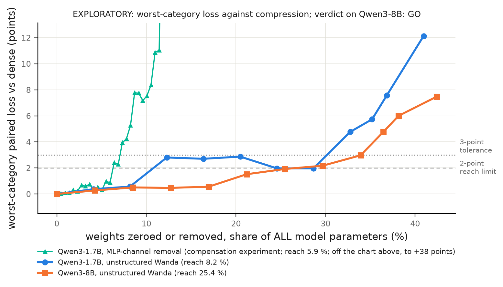

# Unstructured feasibility: report (2026-11-27)

**EXPLORATORY.**
* **The plan,** [`unstructured_feasibility_plan.md`](unstructured_feasibility_plan.md), was committed and pushed
  (`805b7a5`) before any model was scored, including Qwen3-8B's admissibility test. Its decision rule was not changed
  afterwards.
* **The items.** On Qwen3-1.7B, every evaluation item has been seen before. On Qwen3-8B, the items come from its
  screening pool. Its sealed confirmation set was never opened.
* **No speed or memory gain.** Zeroed weights are still stored and multiplied: unstructured sparsity gives no memory or
  speed gain on standard hardware. Every result below is about accuracy at a given number of zeroed weights.

**Sources.** Every number below comes from a run file. The paths are relative to `~/cap-prune-runs/`:

| key | file |
|---|---|
| ⟨analysis⟩ | `unstructured-feasibility/analysis/analysis.json` (rendered as `analysis/analysis.md`; figure `analysis/worst_loss.png`) |
| ⟨level⟩ | `unstructured-feasibility/<model>/levels/sNN/result.json` (scores, timings), `mask.json` (mask hash, exactness, regeneration check), `outcomes.npz` (per-item outcomes) |
| ⟨dense⟩ | `unstructured-feasibility/<model>/dense.json` and `dense.npz` |
| ⟨eval⟩ | `unstructured-feasibility/<model>/eval/eval_set.json` and `items.jsonl` |
| ⟨attain⟩ | `unstructured-feasibility/attainability.json` |
| ⟨model⟩ | `unstructured-feasibility/<model>/model.json` (weight hashes, licence, bf16 load) |
| ⟨run⟩ | `unstructured-feasibility/<model>/run.json` |
| ⟨reg⟩, ⟨adm⟩ | `confirmatory/qwen3-8b/registration.json`, `confirmatory/qwen3-8b/admissibility.json` |

## Verdict: GO

| | value |
|---|---|
| reach on Qwen3-8B | **the 30 % level: 25.43 % of all parameters** (2,082,668,544 zeroed weights; layer sparsity 29.98 %) ⟨analysis⟩ |
| GO needs | reach ≥ 20 % of all parameters |
| NO-GO | reach < 10 % |
| **verdict** | **GO**: 25.43 % ≥ 20 % ⟨analysis⟩ |

* **The reach.** It is the highest level at which the worst category's estimated paired loss against the dense model
  is at most 2.0 points, at that level and every lower one.
  * On Qwen3-8B, every level from 5 % to 30 % stays within 2 points.
  * The 35 % level is the first over: Humanities +2.17 points ⟨analysis⟩.
* **The margin is thin.** Any reach that includes the 25 % level (21.20 % of all parameters) is GO.
  * At 25 % the worst category is **Social Sciences at +1.52 points**, with about 0.63 points of standard error on
    its 1,254 items.
  * That is 0.48 points under the limit, less than one standard error ⟨analysis⟩.
  * At 30 % it is Social Sciences at +1.91, 0.09 under the limit.
  * Had the reach stopped at 20 %, the verdict would have been INCONCLUSIVE.
* **Qwen3-1.7B (descriptive): reach at the 10 % level, 8.17 % of all parameters** ⟨analysis⟩.
  * That is against 5.94 % for MLP-channel removal on the same 12,000 items (compensation feasibility report).
  * The 15 % level is the first over: Other +2.80 points.

## What was run

* **Models** ⟨model⟩:
  * **Qwen3-1.7B** (`Qwen/Qwen3-1.7B` @ `70d244cc`, the only revision ever used).
  * **Qwen3-8B** (`Qwen/Qwen3-8B` @ `b968826d`). This is the same post-trained variant. The licence is Apache-2.0,
    and the model is not gated.
  * Every weight file was hashed against the pinned SHA-256 before each load. For Qwen3-8B, these equal the Hub's
    LFS hashes.
  * Qwen3-8B loads in bf16 on the RTX PRO 6000 Blackwell Max-Q (96 GB): 8,190,735,360 parameters, all bfloat16,
    16.4 GB.
* **Qwen3-8B data, in the plan's order:**
  1. **Sealed with the confirmatory procedure** before any scoring: split seed 2026112701, registration SHA-256
     `f96e8ef2739c316c…` ⟨reg⟩. 13,100 confirmation items are sealed and were never opened.
  2. **Admissibility test** on the gate pool (11,132 items, 0-shot): **overall 67.6 %**, against a threshold of
     40 % ⟨adm⟩. Every category is above its 30 % threshold: STEM 66.0 %, Humanities 63.7 %, Social Sciences 79.2 %,
     Other 71.8 %. Admissible. The test took 125 s, at the plan commit.
  3. **Evaluation set** from the screening pool only ⟨eval⟩, qid SHA-256 `38b7865f…`, 9,927 items in all:
     * STEM: 3,000 of 4,531;
     * Humanities: 3,000 of 3,874;
     * **Social Sciences: 1,254, every item;**
     * **Other: 2,673, every item.**

     The two shortfalls were decided with the user before any scoring and are stated in the plan.
* **Qwen3-1.7B data:** the compensation-feasibility set, reused unchanged: 12,000 items, 3,000 per category, qid
  SHA-256 `7b7e7514…` ⟨eval⟩.
* **Operator.** Uniform one-shot unstructured Wanda, as published:
  * the score is |W| × ‖X_j‖₂, compared within each output row;
  * int(cols × s) weights are zeroed per row in every linear of every block;
  * blocks are pruned in order, each fed by the already-pruned earlier ones;
  * no weight update.

  Details:
  * **The check against the published code** (`locuslab/wanda`) found one difference, the per-row count. The
    published floor is now an option (`pruning.unstructured_count: floor`), and the default is unchanged (plan §4).
  * **Calibration:** 128 C4-train windows of 2,048 tokens (`calibration_indices(seed=0)`), the same windows for both
    models.
  * **Not pruned:** embeddings, the output head and the norms.
* **Levels:** 5, 10, 15, 20, 25, 30, 35, 40, 43, 45 and 50 % layer sparsity, each pruned one-shot from the dense model.
* **Integrity, every level** ⟨level⟩:
  * every row of every linear has exactly int(cols × s) zeros, and every masked weight is zero in the model;
  * the mask hash was persisted before scoring, and the per-item outcomes before the next level.
  * **Regeneration check:** the 5 % masks were generated twice on each model, and the hashes agreed. Qwen3-1.7B:
    `b08d4975dbdea428…`. Qwen3-8B: `8bd43cadb4223969…`.
  * No run crashed, so no level was regenerated.
* **Scoring** ⟨level⟩, ⟨dense⟩:
  * dense and every level, 0-shot, in identical batches (100 per category batch, seeded order, 32,768-token budget);
  * every batch was persisted to a score cache;
  * plus C4 validation perplexity (32 × 2,048 tokens).
* **Cross-check, Qwen3-1.7B dense.** All 12,000 answers are identical to the compensation experiment's dense answers,
  and the dense perplexity is the same, 23.424 ⟨dense⟩.
* **Dense accuracy** (0-shot, on each evaluation set) ⟨dense⟩:

  | | STEM | Humanities | Social Sciences | Other | C4 perplexity |
  |---|---|---|---|---|---|
  | Qwen3-1.7B | 50.57 % | 47.73 % | 61.17 % | 58.17 % | 23.424 |
  | Qwen3-8B | 65.50 % | 63.90 % | 79.90 % | 71.79 % | 16.056 |

## Results

### Worst-category loss, compression and perplexity, every level

⟨analysis⟩ `models.<model>.levels`.
* **Share:** zeroed weights as a share of all model parameters.
* **Worst:** the largest estimated paired loss over the four categories, in points, with the category that has it.
* ← marks the first level above 2 points.

| level | 1.7B share | 1.7B worst (category) | 1.7B ppl / dense | 8B share | 8B worst (category) | 8B ppl / dense |
|---|---|---|---|---|---|---|
| 5 % | 4.08 % | +0.37 (Humanities) | 0.999 | 4.23 % | +0.27 (STEM) | 1.000 |
| 10 % | 8.17 % | +0.57 (Other) | 0.998 | 8.47 % | +0.50 (STEM) | 1.000 |
| 15 % | 12.28 % | **+2.80 (Other)** ← | 1.000 | 12.71 % | +0.47 (STEM) | 1.001 |
| 20 % | 16.36 % | +2.70 (Social Sciences) | 1.009 | 16.96 % | +0.56 (Social Sciences) | 1.006 |
| 25 % | 20.48 % | +2.87 (Social Sciences) | 1.020 | 21.20 % | +1.52 (Social Sciences) | 1.011 |
| 30 % | 24.56 % | +1.97 (Humanities) | 1.043 | **25.43 %** | **+1.91 (Social Sciences)** | 1.020 |
| 35 % | 28.64 % | +1.97 (Social Sciences) | 1.070 | 29.67 % | **+2.17 (Humanities)** ← | 1.039 |
| 40 % | 32.76 % | +4.77 (Other) | 1.115 | 33.91 % | +2.97 (Humanities) | 1.067 |
| 43 % | 35.20 % | +5.73 (Other) | 1.152 | 36.46 % | +4.77 (Humanities) | 1.108 |
| 45 % | 36.84 % | +7.57 (Other) | 1.181 | 38.16 % | +6.00 (Humanities) | 1.150 |
| 50 % | 40.95 % | +12.13 (Other) | 1.335 | 42.40 % | +7.47 (Humanities) | 1.222 |

**Achieved layer sparsity.** It is within 0.04 points of the nominal level at every level, because of the floor per
row: for example 42.97 % (Qwen3-1.7B) and 42.99 % (Qwen3-8B) at 43 % ⟨analysis⟩. The table gives the share of all
parameters, which the rule uses. The zeroed counts are in ⟨analysis⟩ and in the plan's §4 table: the masks match that
table exactly.



Figure: `docs/figures/unstructured_feasibility_worst_loss.png`, a copy of the run file `analysis/worst_loss.png`. It
shows both models, with the 2- and 3-point lines. For context, the Qwen3-1.7B channel-removal trajectory of the
compensation experiment is drawn against the share of parameters removed. It leaves the chart above 13 points and
reaches +38.

### Per category: paired loss against dense, estimate [one-sided 95 % lower, upper], points

⟨analysis⟩ `models.<model>.levels[].categories`. The bounds are Clopper–Pearson union bounds, α = 0.05 on each side.
"Pooled" is over all items of the set.

**Qwen3-8B** (n: STEM 3,000; Humanities 3,000; Social Sciences 1,254; Other 2,673):

| level | STEM | Humanities | Social Sciences | Other | pooled |
|---|---|---|---|---|---|
| 5 % | +0.27 [−0.27, +0.80] | +0.00 [−0.51, +0.51] | +0.00 [−0.56, +0.56] | −0.19 [−0.68, +0.31] | +0.03 |
| 10 % | +0.50 [−0.19, +1.19] | −0.20 [−0.89, +0.49] | −0.24 [−1.06, +0.59] | +0.15 [−0.55, +0.84] | +0.10 |
| 15 % | +0.47 [−0.47, +1.40] | +0.30 [−0.65, +1.25] | −0.64 [−1.83, +0.57] | −0.30 [−1.19, +0.59] | +0.07 |
| 20 % | +0.37 [−0.72, +1.45] | +0.47 [−0.64, +1.57] | +0.56 [−0.93, +2.04] | −0.04 [−1.09, +1.01] | +0.31 |
| 25 % | +0.87 [−0.38, +2.11] | +0.70 [−0.56, +1.96] | +1.52 [−0.29, +3.31] | +0.52 [−0.68, +1.73] | +0.81 |
| 30 % | +0.80 [−0.59, +2.19] | +1.53 [+0.10, +2.97] | +1.91 [−0.05, +3.86] | +0.90 [−0.47, +2.26] | +1.19 |
| 35 % | +1.30 [−0.22, +2.82] | +2.17 [+0.52, +3.80] | +0.88 [−1.30, +3.05] | +1.76 [+0.22, +3.29] | +1.63 |
| 40 % | +2.67 [+0.93, +4.40] | +2.97 [+1.19, +4.74] | +1.75 [−0.61, +4.11] | +2.28 [+0.55, +4.01] | +2.54 |
| 43 % | +3.13 [+1.30, +4.96] | +4.77 [+2.84, +6.69] | +1.59 [−0.99, +4.17] | +2.77 [+0.94, +4.59] | +3.33 |
| 45 % | +3.73 [+1.82, +5.63] | +6.00 [+3.97, +8.02] | +3.91 [+1.26, +6.54] | +3.67 [+1.80, +5.52] | +4.42 |
| 50 % | +6.53 [+4.41, +8.64] | +7.47 [+5.29, +9.63] | +5.82 [+2.90, +8.71] | +5.95 [+3.85, +8.04] | +6.57 |

**Qwen3-1.7B** (n = 3,000 per category):

| level | STEM | Humanities | Social Sciences | Other | pooled |
|---|---|---|---|---|---|
| 5 % | +0.27 [−0.42, +0.95] | +0.37 [−0.31, +1.04] | +0.20 [−0.56, +0.96] | +0.20 [−0.51, +0.91] | +0.26 |
| 10 % | +0.13 [−0.86, +1.13] | +0.20 [−0.86, +1.26] | +0.13 [−0.88, +1.15] | +0.57 [−0.49, +1.62] | +0.26 |
| 15 % | +1.77 [+0.34, +3.19] | +1.77 [+0.30, +3.23] | +2.50 [+1.04, +3.95] | +2.80 [+1.38, +4.22] | +2.21 |
| 20 % | +2.10 [+0.54, +3.66] | +1.70 [+0.10, +3.30] | +2.70 [+1.16, +4.24] | +2.03 [+0.46, +3.60] | +2.13 |
| 25 % | +1.17 [−0.61, +2.94] | +1.67 [−0.02, +3.35] | +2.87 [+1.17, +4.56] | +1.47 [−0.27, +3.20] | +1.79 |
| 30 % | +0.20 [−1.71, +2.11] | +1.97 [+0.17, +3.76] | +1.73 [−0.08, +3.54] | +1.27 [−0.62, +3.15] | +1.29 |
| 35 % | +0.70 [−1.45, +2.85] | +0.60 [−1.39, +2.59] | +1.97 [+0.03, +3.90] | +1.33 [−0.69, +3.35] | +1.15 |
| 40 % | +2.60 [+0.22, +4.98] | +2.27 [+0.08, +4.45] | +2.93 [+0.77, +5.09] | +4.77 [+2.49, +7.03] | +3.14 |
| 43 % | +5.27 [+2.82, +7.71] | +3.37 [+1.04, +5.69] | +5.67 [+3.29, +8.03] | +5.73 [+3.33, +8.13] | +5.01 |
| 45 % | +5.20 [+2.62, +7.77] | +4.63 [+2.13, +7.12] | +7.27 [+4.85, +9.67] | +7.57 [+5.05, +10.07] | +6.17 |
| 50 % | +10.73 [+8.03, +13.42] | +7.93 [+5.23, +10.62] | +11.70 [+9.06, +14.32] | +12.13 [+9.44, +14.80] | +10.62 |

### Social Sciences on Qwen3-8B: the precision stated in the plan

* **What the plan said before scoring.** Social Sciences has only 1,254 items on Qwen3-8B: about 0.85 points of
  standard error at 9 % paired disagreement. So the reach there is conservative, biased toward a lower reach.
* **What happened** (from the counts in ⟨analysis⟩):
  * **Disagreement was lower than assumed,** 5.0–7.4 % in Social Sciences from 25 to 35 %. The standard error at
    those levels was 0.63–0.77 points, against 0.43–0.60 in the other three categories.
  * **Social Sciences was the largest-loss category** at 20, 25 and 30 % (+0.56, +1.52, +1.91), the levels that
    decide between INCONCLUSIVE and GO.
  * **It did not end the reach.** At 35 %, Humanities (+2.17, n = 3,000) crossed 2 points, while Social Sciences was
    +0.88.
  * **Which category leads moves around.** In Social Sciences the noisier estimate moves between levels (+1.91 at
    30 %, +0.88 at 35 %, +1.75 at 40 %). The leading category is STEM up to 15 %, Social Sciences at 20–30 %, and
    Humanities from 35 %.
* **The confirmation rule shows the same limit** (below): its bound stops at 25 % because of Social Sciences' small n.

### The pre-registered confirmation rule on these sets: not a certificate

⟨analysis⟩ `models.<model>.confirmation_rule`. The rule is the per-category IUT with the Clopper–Pearson union bound,
3 points, α = 0.05, fixed sequence over the levels in ascending sparsity, stopping at the first failure.

| model | claim | share of all parameters | levels tested | why the sequence stopped |
|---|---|---|---|---|
| Qwen3-1.7B | 10 % | 8.17 % | 3 | at 15 % every category's upper bound exceeds 3 points (+3.19 to +4.22) |
| Qwen3-8B | 20 % | 16.96 % | 5 | at 25 % Social Sciences' upper bound is +3.31 (estimate +1.52, n = 1,254); the other categories' bounds are at most +2.11 |

### Qwen3-1.7B: unstructured against MLP-channel removal, matched on share of parameters

⟨analysis⟩ `channel_comparison`. The channel trajectories are those of the compensation experiment (its
`analysis/analysis.json`). Each unstructured level is matched to the channel step nearest in share, and that trajectory
ends at 18.28 %.

| level | share (unstructured) | unstructured worst | channel step | share (channel) | channel worst, mask-only | channel worst, compensated |
|---|---|---|---|---|---|---|
| 5 % | 4.08 % | +0.37 (Humanities) | 9 | 4.11 % | +0.30 (STEM) | +0.47 |
| 10 % | 8.17 % | +0.57 (Other) | 18 | 8.23 % | +5.27 (Other) | +5.47 |
| 15 % | 12.28 % | +2.80 (Other) | 27 | 12.34 % | +28.93 (Social Sciences) | +22.53 |
| 20 % | 16.36 % | +2.70 (Social Sciences) | 36 | 16.45 % | +37.87 (Social Sciences) | +36.43 |

* **The reach:** 8.17 % unstructured against 5.94 % for channel removal (13 steps), on the same items and dense
  answers.
* **At equal share,** unstructured zeroing costs far less accuracy past about 6 %: at 12–16 %, 2.7–2.8 points against
  29–38.
* **This is not a like-for-like trade.** Removed channels shrink the model and speed it up on any GPU, and zeroed
  weights do neither on standard hardware. The comparison is accuracy at an equal count of removed or zeroed
  parameters, not at an equal deployment benefit.

### The 43 % level on Qwen3-8B: uniform Wanda at the same overall sparsity, not their method

⟨analysis⟩ `base_paper_comparison`; the base paper's numbers are from `docs/paper/related_work.md`.

| category | paired loss [one-sided 95 %] | dense accuracy | pruned accuracy |
|---|---|---|---|
| STEM | +3.13 [+1.30, +4.96] | 65.50 % | 62.37 % |
| Humanities | +4.77 [+2.84, +6.69] | 63.90 % | 59.13 % |
| Social Sciences | +1.59 [−0.99, +4.17] | 79.90 % | 78.31 % |
| Other | +2.77 [+0.94, +4.59] | 71.79 % | 69.02 % |
| pooled (this set) | +3.33 | 68.53 % | 65.20 % |
| **base paper** (Kodathala & Vunnam), Qwen3-8B at 43.02 % | **20.71 points** (5-shot MMLU 77.38 → 56.67) | | |

**What differs.** The two numbers are not a comparison of methods:
* their sparsity was chosen per layer by an LLM agent with a perplexity rollback, and ours is uniform;
* they used 5-shot MMLU, and we used 0-shot on our evaluation set;
* our related-work notes record an internal inconsistency in their sparsity, about 45 % against 43.02 %.

What can be said: on our set, uniform Wanda at the same overall sparsity loses 1.6–4.8 points per category on Qwen3-8B,
far less than the drop they report.

### Wall time and peak GPU memory per level

⟨level⟩ `seconds`, `peak_gpu_bytes`; ⟨dense⟩. GPU: RTX PRO 6000 Blackwell Max-Q.
* The level total is prune + hash + regeneration check + scoring + perplexity.
* The peak covers the level and includes both resident models: the dense model and its pruned working copy.

| level | 1.7B prune s | 1.7B score s | 1.7B total s | 1.7B peak GB | 8B prune s | 8B score s | 8B total s | 8B peak GB |
|---|---|---|---|---|---|---|---|---|
| dense | – | 91 | 97 | 11.9 | – | 271 | 287 | 38.5 |
| 5 % (+ regeneration check) | 277 (+274) | 92 | 649 | 14.7 | 1,073 (+995) | 241 | 2,324 | 52.4 |
| 10 % | 274 | 94 | 373 | 14.7 | 955 | 241 | 1,211 | 59.4 |
| 15 % | 275 | 96 | 376 | 14.7 | 956 | 241 | 1,212 | 59.4 |
| 20 % | 274 | 94 | 374 | 14.7 | 956 | 242 | 1,212 | 59.4 |
| 25 % | 275 | 94 | 374 | 14.7 | 956 | 242 | 1,213 | 59.4 |
| 30 % | 274 | 94 | 374 | 14.7 | 956 | 242 | 1,212 | 59.4 |
| 35 % | 278 | 94 | 377 | 14.7 | 955 | 242 | 1,211 | 59.4 |
| 40 % | 274 | 94 | 373 | 14.7 | 955 | 241 | 1,211 | 59.4 |
| 43 % | 275 | 94 | 374 | 14.7 | 954 | 241 | 1,209 | 59.4 |
| 45 % | 274 | 94 | 373 | 14.7 | 954 | 241 | 1,209 | 59.4 |
| 50 % | 278 | 93 | 376 | 14.7 | 953 | 240 | 1,208 | 59.4 |

* **Perplexity** took 5 s per level on Qwen3-1.7B and 13 s on Qwen3-8B. Hashing took under 1 s and 1 s.
* **Whole invocations** ⟨run⟩:
  * Qwen3-1.7B: 75 min (4,506 s);
  * Qwen3-8B: 4.1 h (14,751 s);
  * the admissibility test: 125 s ⟨adm⟩.
* **Pruning dominates on Qwen3-8B.** Our sequential Wanda re-runs every earlier block for each block (plan §4), so its
  cost grows with the square of the depth. The published implementation caches the block inputs instead.
* **The first Qwen3-8B level** peaked at 52.4 GB and every later level at 59.4 GB. We did not investigate the
  difference.

## Reading it

* **On Qwen3-8B, uniform unstructured Wanda keeps every category within 2 points up to 30 % layer sparsity,** 25.43 %
  of all parameters. That is GO under the plan's rule.
  * **The margin is thin.** GO rests on the 25 % level, where the worst category, Social Sciences with 1,254 items,
    is 0.48 points under the limit.
  * **With bounds instead of point estimates,** the confirmation rule on the same items reaches 20 % (16.96 %).
* **Size matters a great deal.** At the same layer sparsity, the 8B model loses much less. The 1.7B model already
  loses 1.8–2.8 points in every category at 15 %, where the 8B model is within ±0.7. The reaches are 8.17 % against
  25.43 % of all parameters.
* **On Qwen3-1.7B the loss has a plateau, not a cliff.**
  * From 15 % to 35 % the worst category stays between +1.97 and +2.87 points.
  * Disagreement keeps rising (8 % to 19 % of items), with gains offsetting losses.
  * From 40 % the loss climbs steeply.
  * The point-estimate reach ends at the first level of the plateau.
* **Against channel removal on Qwen3-1.7B,** unstructured zeroing costs far less accuracy per parameter, but it buys no
  speed or memory on standard hardware. A study that wants a deployable gain needs a hardware pattern (2:4, or
  structured) or sparse kernels.
* **C4 perplexity misses the MMLU loss.**
  * On Qwen3-1.7B at 15 %, perplexity is unchanged (ratio 1.000) while every category loses 1.8–2.8 points.
  * On Qwen3-8B at 35 %, the perplexity ratio is 1.039 with Humanities at +2.17.
  * This agrees with the project's earlier finding that a perplexity gate does not protect categories.
* **Limits of this test:**
  * one operator, uniform across layers;
  * one calibration set;
  * point estimates on 9,927 to 12,000 items;
  * seen items on Qwen3-1.7B;
  * screening items on Qwen3-8B;
  * 0-shot scoring only.

  The verdict is a go/no-go screen for a larger study, not a certificate.

## Notes and deviations

* **The Qwen3-8B evaluation set has fewer than 3,000 items in two categories:** Social Sciences 1,254 and Other 2,673,
  every item of the screening pool. The seal leaves no more. This was decided with the user and written into the
  plan before any scoring. The plan's statement about Social Sciences' precision is repeated above.
* **The Wanda count.** We use the published per-row count (floor), not the repository's earlier rounding, through a
  new option. Existing configurations are unchanged (plan §4).
* **Time.** The plan expected "several minutes per level" on Qwen3-8B, and pruning took 16 minutes per level. Nothing
  else changed.
* **Commits.** Each run file records its commit, tree state and GPU (RTX PRO 6000 Blackwell Max-Q):

  | step | commit |
  |---|---|
  | Qwen3-8B config and seal | `d81c49a` |
  | admissibility, both evaluation sets, both runs (dense and all levels) | `805b7a5`, the plan commit |
  | analysis | `4712ef0` |

  * Every run was from a clean worktree.
  * The analysis was first run at `805b7a5`, with identical numbers and verdict (checked: `analysis.json` equal
    apart from its metadata). It was rerun at `4712ef0`, which only changed the figure's layout.
* **Standing rules:**
  * No sealed confirmation set was opened. Qwen3-8B's sealed rows were written by the seal and never read. Its sealed
    id list was read only by the pre-registered admissibility test's split check.
  * Neither SmolLM3 nor Granite was loaded.
  * No recorded result was changed.
  * Nothing else used the GPU while models were scored: the full test suite finished before the admissibility test,
    and the analysis ran after the last level.
* **Disk.** The run files take 36 MB (masks are not stored, only their hashes), the Qwen3-8B seal 7.4 MB, and its
  prepared data 45 MB.

## Commands

```bash
python -m capprune prepare                    --config configs/confirmatory_qwen3_8b.yaml
python -m capprune confirmatory build-data    --config configs/confirmatory_qwen3_8b.yaml
python -m capprune unstructured attainability --config configs/unstructured_feasibility.yaml
python -m capprune unstructured models        --config configs/unstructured_feasibility.yaml --model qwen3-8b
python -m capprune confirmatory admissibility --config configs/confirmatory_qwen3_8b.yaml
python -m capprune unstructured build-eval    --config configs/unstructured_feasibility.yaml --model qwen3-8b
python -m capprune unstructured build-eval    --config configs/unstructured_feasibility.yaml --model qwen3-1.7b
python -m capprune unstructured run           --config configs/unstructured_feasibility.yaml --model qwen3-1.7b
python -m capprune unstructured run           --config configs/unstructured_feasibility.yaml --model qwen3-8b
python -m capprune unstructured analyze       --config configs/unstructured_feasibility.yaml
```
